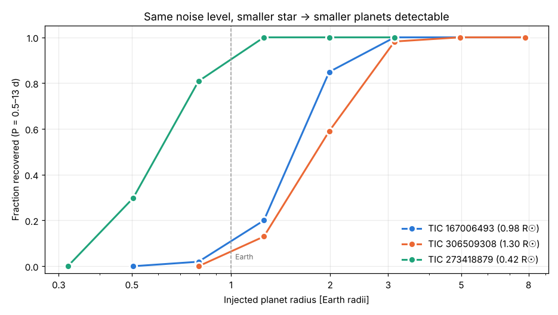
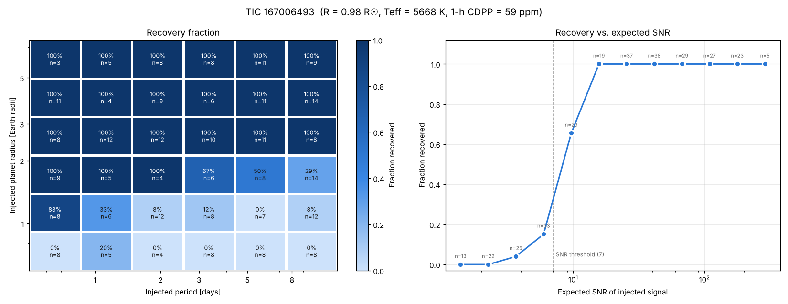
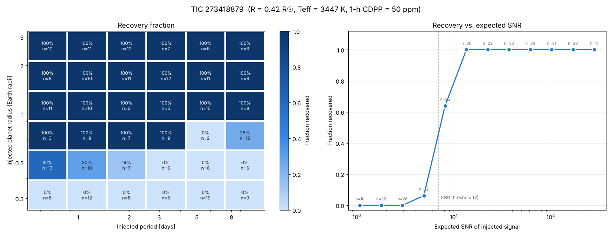

# Planets: a TESS transit search, built to learn the method

A small, readable pipeline that downloads public NASA TESS light curves,
cleans them, and searches for transiting planets with Box Least Squares
(BLS).

**Status:** the pipeline recovers known planets, and injection-recovery
tests have mapped what it can and can't find. Use it for discovery only
after it has passed both tests.

```
transit_search.py              the whole pipeline (download → clean → BLS → plots → CSV)
validate_known_planets.py      runs the pipeline on known_planets.csv
known_planets.csv              known planet hosts with their published periods
injection_recovery.py          inject fake planets into real data, map what we recover
vetting.py                     planet size, nearby stars, known planet/TOI/CTOI cross-match
../feed/                       the Discovery Queue page and its card format
run_injection_recovery.py      runs injection-recovery on quiet_stars.csv
quiet_stars.csv                test stars with no signal of their own
notebooks/01_recover_known_planet.ipynb   step-by-step walkthrough on Pi Mensae c
notebooks/02_injection_recovery.ipynb     how sensitive is the search?
tests/                         offline tests (synthetic transits, regression tests)
```

## Quick start

```bash
# from the repository root
python -m venv .venv && source .venv/bin/activate
pip install -r requirements.txt
pytest                                   # offline tests (~1 min)

# then from planets/
cd planets
python validate_known_planets.py         # downloads TESS data, writes results/
python run_injection_recovery.py         # sensitivity maps (~15 min per star, 4 cores)
jupyter lab notebooks/                   # the walkthrough
```

In Python:

```python
import transit_search as ts

result = ts.search_target("TIC 261136679", show=True)    # Pi Mensae
table  = ts.search_many(["TIC 261136679", "TIC 100100827"], csv_path="results.csv")
```

Star names such as `"Pi Men"` also work, but lightkurve then needs MAST's
name-lookup service (`mastresolver.stsci.edu`). TIC IDs skip that lookup, so they
are more robust.

Each CSV row contains the best period, mid-transit time (`t0_btjd`), duration,
depth, depth SNR, SDE, number of transits, and odd/even depths. If you supply
`known_period_days`, it also adds a `period_check` column (`match`,
`alias 2x`, `alias 1/2x`, `miss`).

---

## What is a transit?

When a planet passes in front of its star as seen from Earth, it blocks a
small fraction of the starlight. The star dims a little for a few hours, then
recovers, and this repeats every orbit.

```
flux
1.000 ──────────┐          ┌──────────────────┐          ┌──────
                │          │                  │          │
0.9997          └──────────┘                  └──────────┘
                 ← duration →
                ←──────────── period ─────────→
```

Three numbers describe it:

- **Depth** ≈ (R_planet / R_star)². Jupiter in front of the Sun gives about 1%
  (10,000 ppm). Earth in front of the Sun gives about 0.008% (84 ppm).
- **Period**: the orbital period, i.e. the time between transits.
- **Duration**: how long the planet takes to cross the disk. This depends on
  the period, the star's size, and how centrally the planet crosses
  (the "impact parameter").

TESS photographs most of the sky every 2 minutes (or every 20 s to 30 min,
depending on the data product) for ~27-day "sectors". A **light curve** is
one star's brightness over that time.

## The pipeline, step by step

1. **Download** (`download_light_curve`). We use SPOC **PDCSAP** flux. NASA's
   pipeline has already removed most spacecraft systematics (pointing jitter,
   scattered light) and corrected for light from nearby stars. Cadences
   flagged as bad (for example during momentum dumps) are dropped.
2. **Clean** (`clean_light_curve`).
   - *Remove NaNs*: gaps and flagged cadences.
   - *Flatten*: stars vary on their own. Starspots rotate in and out of
     view, and stars pulsate and flare. At each moment we fit a curve
     (quadratic) to the surrounding 1 day of data, then divide it out
     (`robust_trend`). Three details matter:
     - The fit is **robust**: points far from the curve, like a transit or a
       flare, get little or no weight (Tukey's biweight, the method
       Hippke et al. 2019 found best for transit searches).
     - The window never crosses a data gap.
     - Nothing is interpolated across gaps or masked points.

     The window must be **much longer than a transit** (1 day, against
     transits of a few hours), or the curve starts to follow the dip.
     We first used lightkurve's Savitzky–Golay `flatten()`. Injection tests
     showed it creates 500–1000 ppm steps next to transits: it splits the
     data at every clipped point and replaces short pieces with a flat
     level. That cost sensitivity and caused false periods.
   - *Clip outliers asymmetrically*: transits are dips, so we clip upward
     spikes (cosmic rays, flares) hard but leave low points alone. A
     symmetric clip can delete the transit you are looking for.
3. **Search** (`run_bls`). See below.
4. **Detect, then measure** (`search_light_curve`). Even a robust 1-day fit
   bends slightly toward a shallow transit at its centre, so blind
   flattening makes shallow transits look too shallow (Pi Men c: 219 ppm
   blind vs. 267 ppm). So:
   - *Pass 1 (detect)*: flatten blindly and run BLS. Period, t0, SDE and
     `is_candidate` come from this pass **only**.
   - *Pass 2 (measure)*: mask the pass-1 transits, flatten again so the
     trend is fitted only to out-of-transit data, and re-measure depth, SNR
     and odd/even **at the same ephemeris**.

   Pass 2 must not search again: a search on data shaped by the pass-1
   mask can "re-discover" whatever pass 1 picked, even noise.
   Injection-recovery tests caught this with the old flattening.
5. **More planets** (`search_multi`). After a detection, mask that signal's
   transits (out of the trend fit, then out of the data) and search again,
   up to three signals. This finds a second planet hiding behind a stronger
   one, including next to an already-known planet.
6. **Plot** (`plot_diagnostics`). Four panels: raw, flattened (with
   predicted transit times), periodogram, folded light curve.

## How Box Least Squares works

BLS (Kovács, Zucker & Mazeh 2002) models a transit as a **box**: the flux is
at one level out of transit and a lower level in transit. For every trial
combination of

- **period** P (thousands of values),
- **duration** (we try 0.5–8 hours),
- **phase** (when in the orbit the box sits),

it folds the light curve at P, places the box, and computes how much better
"flat line + box" fits the data than a flat line alone. The improvement is
the **BLS power** (here the change in log-likelihood). Plotting the best
power for each period gives the **periodogram**. A real periodic transit
shows up as a sharp peak, usually with smaller peaks at P/2, 2P, and so on.

Why a box rather than a realistic transit shape? It is fast enough to test
millions of combinations. It is also close enough to the real shape to find
the signal. Detailed modelling (limb darkening, ingress/egress) comes later,
once you have a candidate.

**Physical durations only.** A transit can only last a small fraction of
the orbit: at most ~12% at P = 0.5 d around a Sun-like star, and less at
longer periods. If BLS may try any duration at any period, it will
happily fit an 8-hour box to a 1-day "orbit". The long box catches lots of
data and can outscore a real short transit. Injection tests caught this
too, so `run_bls` only tries durations up to `MAX_DUTY_CYCLE` (15%) of
the period.

**The period grid.** Periods are spaced evenly in frequency, with spacing
set by the shortest duration and the total time span. A longer time span
needs a finer grid, and the number of trial periods grows roughly with the
**square** of the span. That is why the defaults use one sector, and why
stitching sectors from years apart is slow.

### Measures of signal strength

| Quantity | Meaning | Rule of thumb |
|---|---|---|
| `sde` | Signal Detection Efficiency: (peak − mean power) / std of power. How far the peak stands above the rest of the periodogram. | ≳ 9 interesting |
| `depth_snr` | depth / uncertainty on depth | ≳ 7 interesting |
| `n_transits` | individual transits that have data | ≥ 2 to know a period; ≥ 3 preferred |
| `odd_even_sigma` | difference between odd- and even-numbered transit depths, in σ | ≳ 3 suspicious (see below) |
| `odd_even_diff_pct` | the same difference as a % of the depth | ≳ 20% suspicious (vetting flags > 20% and > 3σ) |

`is_candidate` is `True` when SDE ≥ 9 and SNR ≥ 7. These are thresholds
for "look closer", not proof.

## Real planets vs. false positives

**Most transit-like signals are not planets.** Before believing a signal,
work through these checks:

**Eclipsing binaries (EBs).** These are two stars orbiting each other. They are the most
common impostor.
- *Odd/even depth difference.* If the two stars differ, the primary and
  secondary eclipses have different depths. BLS often finds half the true
  period, which folds the two eclipses on top of each other. A large
  `odd_even_sigma` is a warning sign. Check the periodogram peak at 2P
  as well. Read it together with `odd_even_diff_pct`: on the bright hot
  Jupiters in our validation set, odd and even depths differ by only 2–5%
  but that is 3–6σ, because at SNR ~500 even small systematics (such as a
  transit cut off at the edge of a data gap) are "significant". A real EB
  usually differs by tens of percent.
- *Secondary eclipse.* Fold at the period and look at phase 0.5. A dip
  there means the companion emits its own light, so it is probably a star.
  (Very hot Jupiters can show a tiny secondary eclipse too, but only tens
  of ppm.)
- *Shape.* Planets give flat-bottomed, "U"-shaped transits. Grazing EBs
  give "V" shapes with no flat bottom.
- *Too deep / too long.* A depth over a few percent, or a duration longer
  than a planet could have around that star, implies a companion
  bigger than a planet.

**Blended (background) eclipsing binaries.** TESS pixels are big (21″),
so light from several stars mixes in one aperture. A deep EB a few pixels
away, diluted by your bright target, can look like a shallow planet
transit. Checking for this requires the pixel data (target pixel files):
does the dip come from the target star? lightkurve can help here.

**Stellar variability and noise.**
- Flattening with a window that is too short creates fake dips, and so
  does leftover spot modulation.
- Spacecraft effects (momentum dumps, scattered light at the start of an
  orbit) cause dips at the same time in many stars. If several unrelated
  stars "share" a transit time, it is the spacecraft.
- A single dip is not a period. Check `n_transits` and look at each
  transit in panel 2: one bad cadence can dominate a fold.
- Peaks at exactly **13.7 days** (the TESS orbit) or at 1 day and its
  fractions are suspicious.

**Aliases.** The BLS peak can be at P/2 or 2P of the true period. Panel 3
marks both. If the folded curve at 2P shows two dips of equal depth, the
true period is P.

**What astronomers do next** (outside this project's scope): check that the
signal appears in independent sectors, inspect the pixels for the source of
the dip (centroid tests), compare against Gaia for nearby stars, fit a
physical transit model, and finally confirm with radial velocities. NASA's
TESS team runs a version of this "vetting" before it publishes
a TOI (TESS Object of Interest).

## Validation plan

1. ✅ Offline: inject synthetic transits, check period/depth/duration come
   back (`pytest`).
2. ✅ `validate_known_planets.py` on one TESS sector each:

   | Planet | Published P (d) | BLS P (d) | Depth (ppm) | Duration (h) | SDE | SNR |
   |---|---|---|---|---|---|---|
   | Pi Men c | 6.2678 | 6.2687 | 276 | 3.0 | 19.6 | 65 |
   | WASP-18 b | 0.94145 | 0.94149 | 9,773 | 2.0 | 15.8 | 686 |
   | WASP-126 b | 3.2888 | 3.2880 | 6,532 | 3.0 | 15.4 | 126 |
   | WASP-121 b | 1.27492 | 1.27513 | 13,193 | 3.0 | 13.9 | 474 |
   | LHS 3844 b | 0.46293 | 0.46296 | 4,087 | 0.5 | 26.0 | 34 |

   All five match their published periods. The durations are coarse
   because they snap to the trial grid (0.5, 1, 1.5, 2, 3 … h).
3. ✅ Injection-recovery on real light curves of quiet stars. See
   [Injection-recovery](#injection-recovery-what-could-we-have-found) below.
4. ☐ Only then: run it on stars without known planets.

## Injection-recovery: what could we have found?

Finding known planets shows the pipeline *can* work. It doesn't show what
it misses. To find out, `run_injection_recovery.py` takes real TESS light
curves of three quiet stars that show no signal of their own:

| Star | Type | Radius | 1-h noise (CDPP) |
|---|---|---|---|
| TIC 167006493 | solar twin (G2) | 0.98 R☉ | 59 ppm |
| TIC 306509308 | G dwarf | 1.30 R☉ | 54 ppm |
| TIC 273418879 | M dwarf | 0.42 R☉ | 50 ppm |

It injects 300 fake planets into each star. Each fake planet has:
- a period from 0.5 to 13 d
- a depth from 30 to 5000 ppm
- a random impact parameter
- a trapezoid shape, with the duration set by Kepler's law and the star's density

Then it runs the **unchanged** production search on every one.



**Results** (one sector, P = 0.5–13 d, current pipeline):

| | Solar twin | 1.3 R☉ G dwarf | M dwarf |
|---|---|---|---|
| 50% recovery radius | 1.45 R⊕ | 1.72 R⊕ | **0.58 R⊕** |
| 50% recovery radius, P < 3 d | 1.19 R⊕ | 1.42 R⊕ | 0.50 R⊕ |
| 50% recovery at expected SNR | 8.6 | 8.5 | 8.0 |
| Recovered at expected SNR > 15 | 100% | 100% | 100% |

What this tells us:
- **No strong signal was missed.** Every injection with expected SNR > 15
  (519 of them) came back at the right period and transit times. Misses
  happen only near the detection threshold, where they should.
- **M dwarfs are where small planets are findable.** The noise level is the
  same, but the star is 2.3× smaller, so an Earth-sized planet makes a ~6×
  deeper dip. Around this M dwarf, the pipeline finds 85% of 0.7–0.9 R⊕
  planets. Around the solar twin it finds 4%.
- **A "nothing found" is now quantified.** With one sector of this solar
  twin, we'd have caught 91% of ~2 R⊕ planets with P < 13 d and every
  planet bigger than 3 R⊕.
- **Choosing the SDE threshold with data.** Near the threshold, most
  injections the search *found at the right period* were thrown out only
  because SDE was below 9. Using the near-zero-depth injections as
  pure-noise trials (105 of them), we compared cut-offs:

  | SDE ≥ | 9 | 8 | 7.5 | 7 |
  |---|---|---|---|---|
  | False alarms on noise | 0% | 0% | 0% | 2% |
  | Recovery at SNR 7–15 | 65% | 71% | 73% | 78% |

  We use **SDE ≥ 8**: a clear gain with margin before false alarms appear.
  Noisier, more active stars will produce more false alarms than these quiet
  ones, so the margin is deliberate.
- **The flattening change didn't move these numbers** (1.54 → 1.56 R⊕ on
  the solar twin before the threshold change, i.e. noise). The old
  flattening's steps hurt variable stars and multi-planet systems, not single
  planets on quiet stars. The new trend fit is still worth it for those
  cases, as the two-planet regression test shows.

<details><summary>Per-star maps (period × radius)</summary>




</details>

**Bugs these tests found** (all fixed, with regression tests):
1. BLS fit 8-hour boxes to ~1-day periods, which outscored real short-period
   transits. Fix: durations are capped at 15% of the period.
2. The masked second pass searched again and could "re-discover" pass-1
   noise. Fix: pass 2 only measures; it never searches.
3. lightkurve's `flatten()` created 500–1000 ppm steps beside transits,
   which produced a false period in a two-planet test. Fix: `robust_trend`.

Caveats: the injections go into PDCSAP flux, which NASA has already
detrended. So this tests our pipeline, not NASA's detrending, and it is a
little optimistic. Each star used one sector; multi-sector and FFI data
need their own runs.

## Vetting: is it new, and could it be a planet?

`vetting.py` checks every signal against:
- **TIC stellar radius**: gives the planet radius. Anything over
  2 R_Jupiter is a star, so the signal is flagged "not a planet".
- **Odd/even depths**: a big difference suggests an eclipsing binary at
  twice the period.
- **Nearby TIC stars**: lists every star within 3 TESS pixels bright
  enough to cause the dip by being fully eclipsed.
- **Known signals**: confirmed planets and TOIs (NASA Exoplanet Archive)
  and CTOIs (ExoFOP), matched by TIC ID and period, including 2× and ½×.
  A signal on a known host *at a different period* is reported as a possible
  extra planet, not rejected. A match on a nearby star flags contamination.

## Other-sectors check (before anything reaches the queue)

A "possible new" signal is searched again, blind, with the full pipeline in
TESS sectors that weren't used to find it (back-to-back sectors joined).
It only becomes a card if the same period comes out on top again, or, for
stars with no other sectors, if its SNR is at least 10.

| Star | Result |
|---|---|
| Pi Men c, WASP-126 b, LHS 3844 b (real) | confirmed in other sectors |
| TIC 394015919, TIC 111265988 (first-batch candidates) | not confirmed: absent where expected at SNR 13–30 |
| TIC 138762614 (first batch) | single sector, SNR 8.2: held back |

A first attempt measured the deepest dip near the period with a free phase.
It "confirmed" noise and rejected Pi Men c, because it always finds the
biggest systematic. The blind re-search is the fair test.

## Discovery Queue (phone review)

`../feed/discovery_queue.html` is published as a private claude.ai page.
Candidates from every search appear as cards: plot, key numbers,
vetting notes and a link to ExoFOP. You mark each one **Worth a look /
Unsure / Not real**, with optional notes. Claude reads the verdicts back,
follows up on the promising ones and drafts reports. You submit them from
your own accounts (ExoFOP for CTOIs).
`../feed/candidates.py` defines the card format shared by all searches.

## Data and credits

TESS data come from the Mikulski Archive for Space Telescopes (MAST) via
[lightkurve](https://docs.lightkurve.org/). BLS is
[`astropy.timeseries.BoxLeastSquares`](https://docs.astropy.org/en/stable/timeseries/bls.html).
Published periods in `known_planets.csv` are approximate and come from the discovery
papers. Check them against the
[NASA Exoplanet Archive](https://exoplanetarchive.ipac.caltech.edu/).
